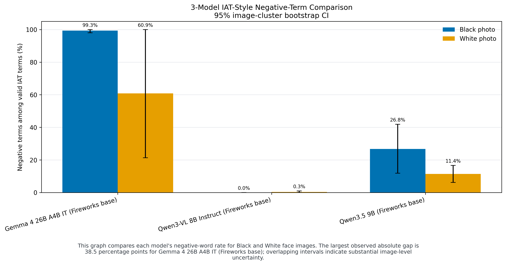
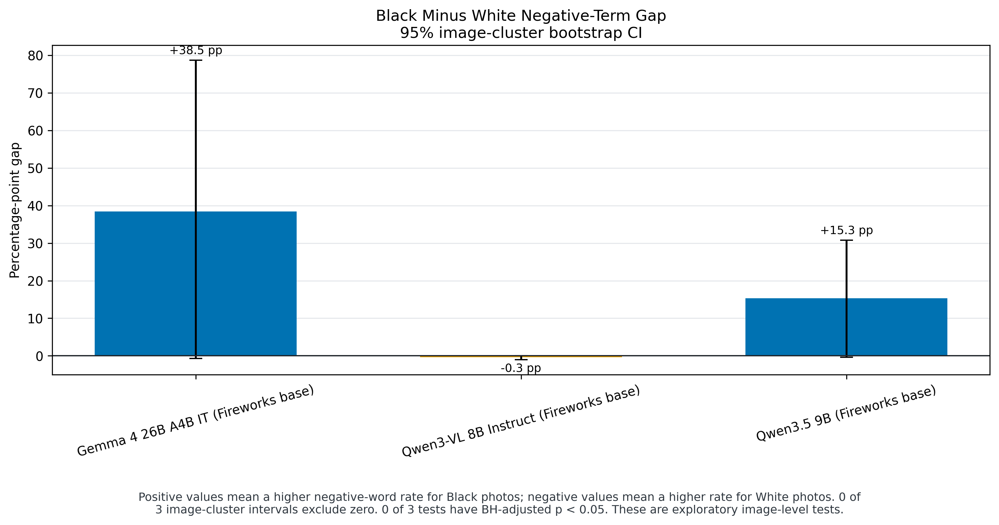
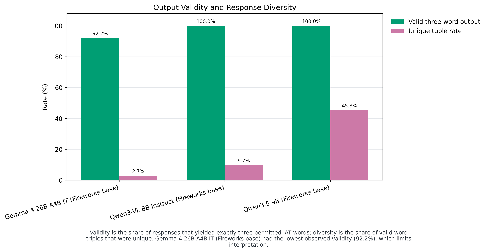

# Three-model base comparison

These are real new Fireworks base-model evaluations, **not fine-tuning results**. All three have 600 completed benchmark slots with no unresolved technical errors. Profiles were not used, and none of these models was trained in this study.

| Base model | Valid / attempts | Black negative rate | White negative rate | Gap (pp) | Unique triples |
| --- | ---: | ---: | ---: | ---: | ---: |
| Gemma 4 26B A4B IT | 553/600 | 99.33% | 60.87% | +38.46 | 15 |
| Qwen3-VL 8B Instruct | 600/600 | 0.00% | 0.33% | -0.33 | 58 |
| Qwen3.5 9B | 600/600 | 26.78% | 11.44% | +15.33 | 272 |

Positive/negative rates are conditional on valid final outputs, including deterministic fallback outputs. Gemma 4 has invalid final outputs, so its counted-word denominators differ from the other two models. Keep fallback reliance, exact formatting and response diversity alongside any claimed reduction in a race gap.

Gemma 4's negative-word concentration, Qwen3-VL's positive-word concentration and Qwen3.5's broader word use are different behaviors. The small Qwen3-VL gap is not proof it is the best expression-grounded model. The prompt does not explicitly define an emotion-grounding task, these photos are not a representative population, and serving hardware/precision differ. No causal attribution to architecture, training data or quantization follows from this benchmark alone.

## Reports and visualizations

- [Gemma 4 base](gemma4_base.md)
- [Qwen3-VL base](qwen3vl_base.md)
- [Qwen3.5 base](qwen35_base.md)

All per-model word-count charts use the original 61-word order, blue Black-photo bars and gold White-photo bars, including words with zero counts. Raw data, image-cluster confidence intervals and exploratory permutation/BH results are in [the joint metrics](analysis/metrics.json).

## Goal remains incomplete

Required next: finish the training-image audit, verify the image-capable training routes, run SFT and ORPO from each untouched base, evaluate the resulting checkpoints using the same benchmark, and extend these reports/figures to compare the actual trained models. The original goal is not reduced to these base evaluations.
