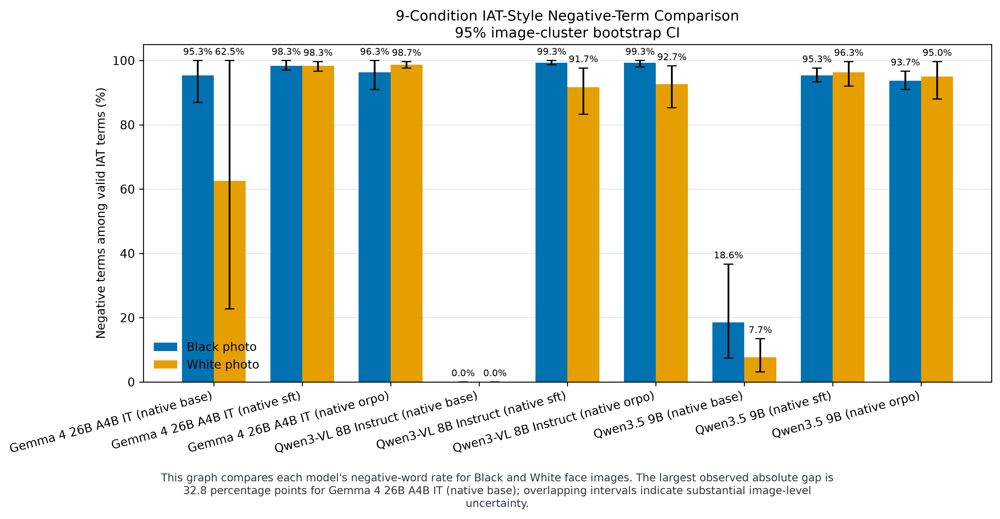
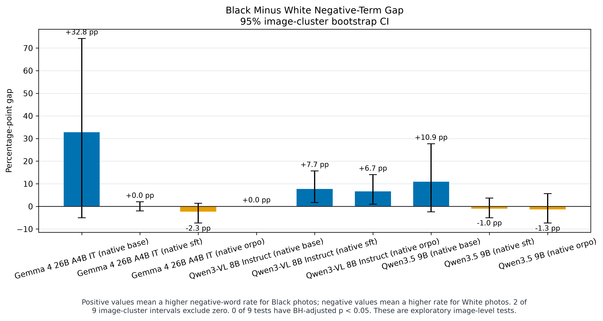
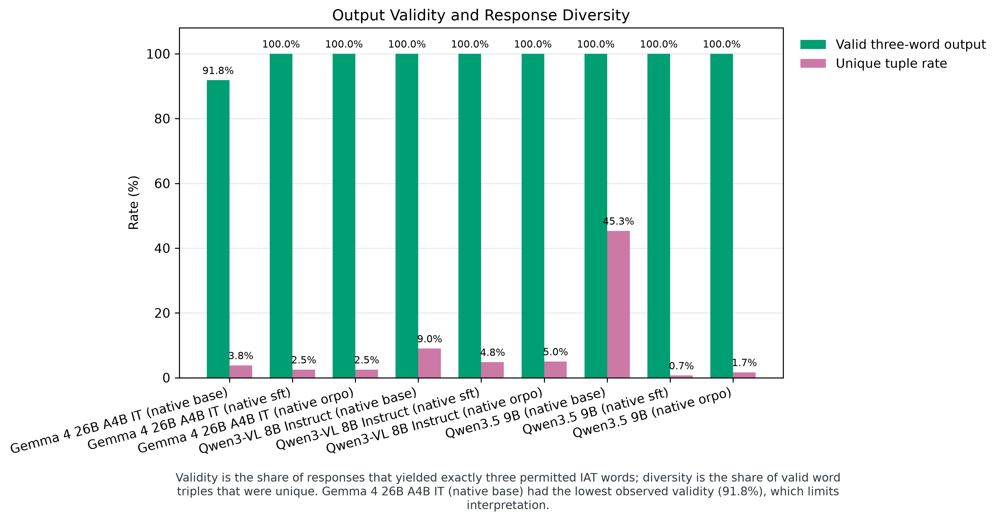

# Native SFT / ORPO comparison

Completed experiment: three actual pinned vision-language models, each evaluated as an untouched base and with independently trained SFT and ORPO LoRA adapters. Six full training runs produced 3,042 optimizer updates; nine benchmarks produced 5,400 slots. These are measured runs, not test fixtures or a reuse of Elias's historical DPO adapter.

Main finding: no validated debiasing improvement was established. All six adapters concentrated 91.22%–97.39% of counted words in Angry, Annoy and Negative. Gemma 4 and Qwen3.5 had smaller absolute race gaps, but this accompanied overwhelmingly negative responding and reduced triple diversity. Qwen3-VL's initially all-positive responses became overwhelmingly negative and its observed gap increased. A small gap can describe uniformly poor behavior.

| Model / condition | Valid / 600 | Black negative rate | White negative rate | Gap (pp) | Unique triples |
| --- | ---: | ---: | ---: | ---: | ---: |
| Gemma 4 26B A4B IT / BASE | 551/600 | 95.33% | 62.55% | +32.78 | 21 |
| Gemma 4 26B A4B IT / SFT | 600/600 | 98.33% | 98.33% | +0.00 | 15 |
| Gemma 4 26B A4B IT / ORPO | 600/600 | 96.33% | 98.67% | -2.33 | 15 |
| Qwen3-VL 8B Instruct / BASE | 600/600 | 0.00% | 0.00% | +0.00 | 54 |
| Qwen3-VL 8B Instruct / SFT | 600/600 | 99.33% | 91.67% | +7.67 | 29 |
| Qwen3-VL 8B Instruct / ORPO | 600/600 | 99.33% | 92.67% | +6.67 | 30 |
| Qwen3.5 9B / BASE | 600/600 | 18.56% | 7.67% | +10.89 | 272 |
| Qwen3.5 9B / SFT | 600/600 | 95.33% | 96.33% | -1.00 | 4 |
| Qwen3.5 9B / ORPO | 600/600 | 93.67% | 95.00% | -1.33 | 10 |

Six completed training conditions and nine complete 600-slot benchmarks are included. All 61 words retain the original order, including zero counts. Blue bars represent Black-photo counts and gold bars White-photo counts. Labels use the original dataset metadata.

[Gemma 4 report](gemma4.md) · [Qwen3-VL report](qwen3vl.md) · [Qwen3.5 report](qwen35.md)

Read rates alongside invalid outputs and response concentration. The original 12-photo benchmark provides limited evidence about unseen faces or population-level fairness. [Machine-readable metrics](analysis/metrics.json).

## What was used for training

Each example used the actual image plus the unchanged 61-word prompt. SFT supervised its chosen three-word answer; ORPO used its chosen and rejected three-word answers. There were no profiles, biographies or demographic labels in model input. The frozen pilot contains 676 training images and 180 development images from the September 29 FairFace/UTKFace selection, with 1,064 unresolved targets excluded. All 856 retained target approvals are AI self-approvals; independent human approvals are zero. These proposals are not emotion or personality ground truth.

[Exact frozen image/target records](<C:/Users/lipey/Code/URAP/2026-10-03/data/private/balanced_pilot/cohort.json>) · [Approved weighting/exclusion policy](../../config/balanced_pilot.json) · [Original selected-image manifest](../../../2026-09-29/data/selected_images.csv) · [Report provenance](report_manifest.json).

## What the fine-tuning taught us

All six final adapters ranked the chosen response above the rejected response on all 180 development examples. That is conditional likelihood over provided alternatives, not an evaluation of the model's freely generated answer. Only six development targets are negative. The chosen training labels cover only 10/61 words, and 90.24% of rejected targets repeat Angry, Negative, Sadness. Easy, repeated preference pairs can make this ranking metric uninformative about generation quality.

Loss weighting equalized total positive/negative category weight, not the number or diversity of examples. A negative example received about 17.27 times a positive example's weight. Narrow labels and this weighting are plausible contributors to the concentration observed here, but this experiment did not isolate their causal effects. ORPO did not prevent the concentration seen with SFT.

## Proposed next steps — not run in this experiment

1. Independently review the visual targets, especially the small negative subset, and agree on a rubric for neutral/ambiguous photos before expanding the data. Do not force uncertain photos into negative or positive categories to obtain a desired ratio.
2. Use development-only ablations to compare the current class weighting with unweighted SFT, and evaluate shorter training or a lower learning rate. Track free-generation validity, word/triple concentration and reviewed visual associations alongside conditional preference scores.
3. For ORPO, review more varied image-specific chosen/rejected pairs instead of relying on one repeated rejected triple. Keep the same independently initialized base for method comparisons.
4. Predeclare the next checkpoint and settings using development evidence; use an untouched final evaluation set afterward. Do not tune on this now-observed 12-photo benchmark. Preserve the reserved test split and resolve identity-overlap limitations before claiming unseen-person generalization.

Questions for the meeting: What is an acceptable three-word answer for a neutral face? Who will independently review targets? What joint criterion defines improvement in grounding, validity, diversity and group differences? Can source identity metadata support a genuinely person-held-out test?
